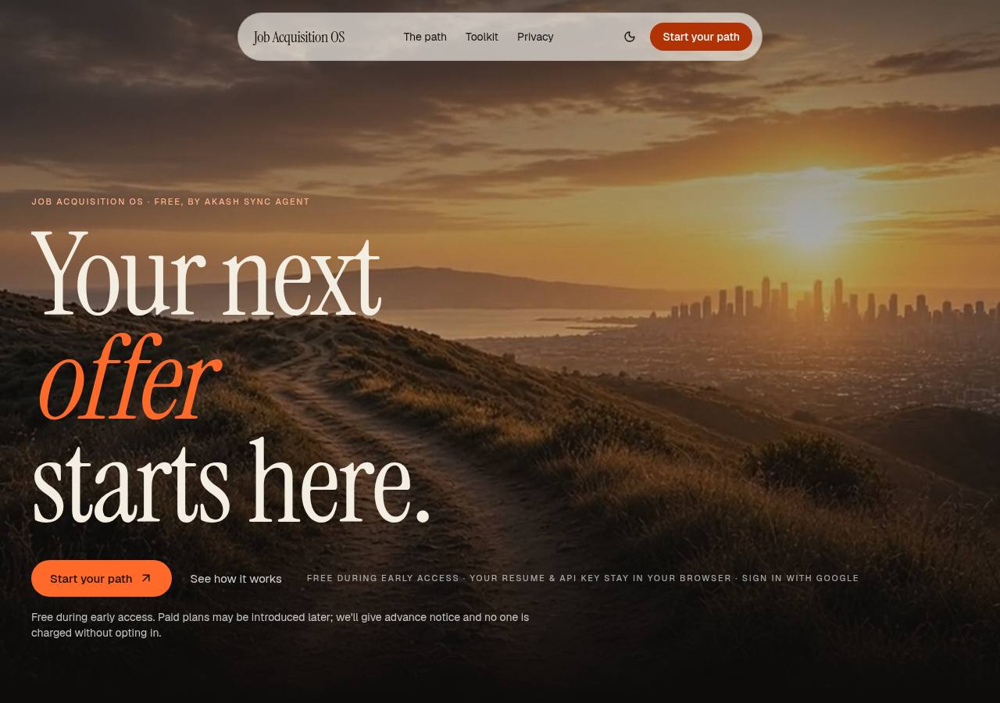
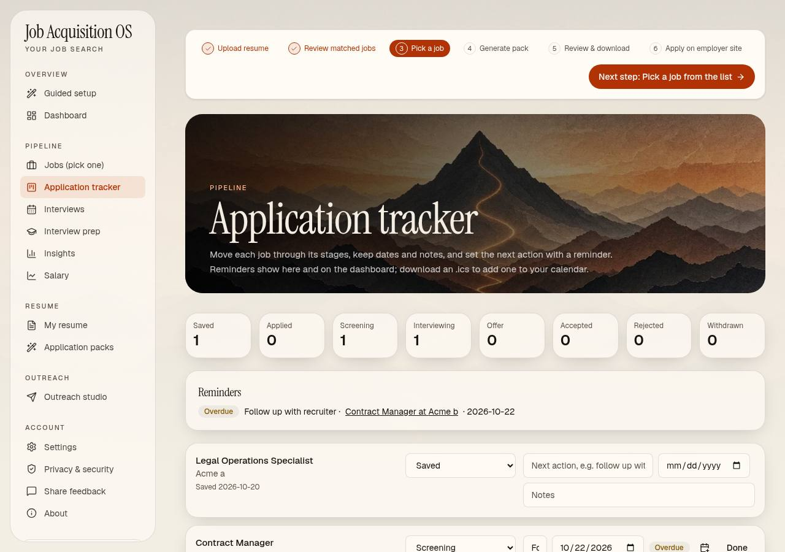
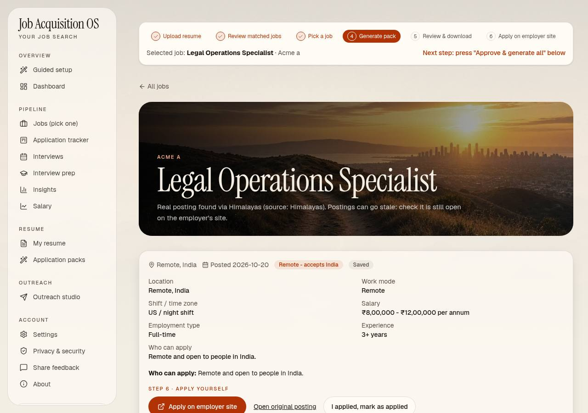
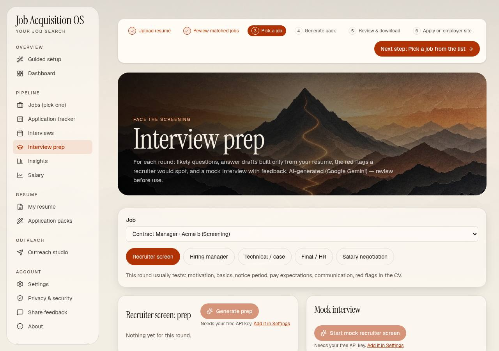
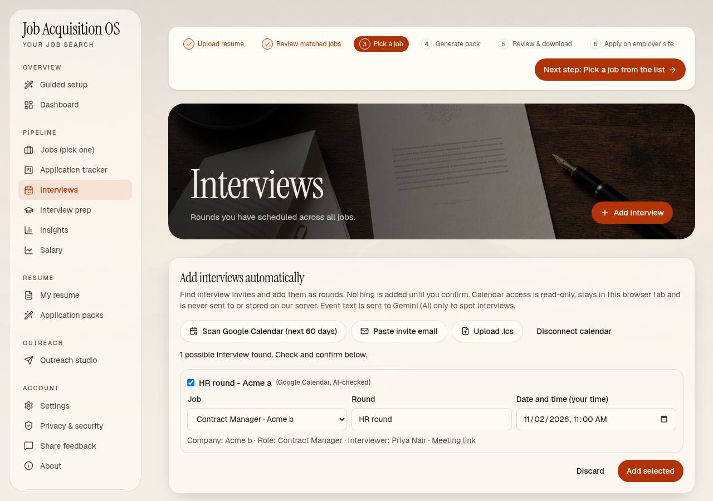
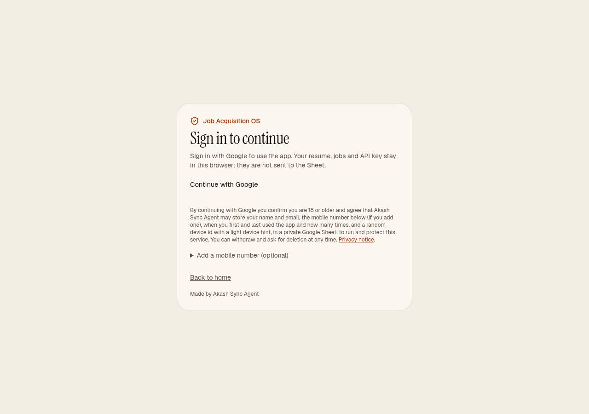
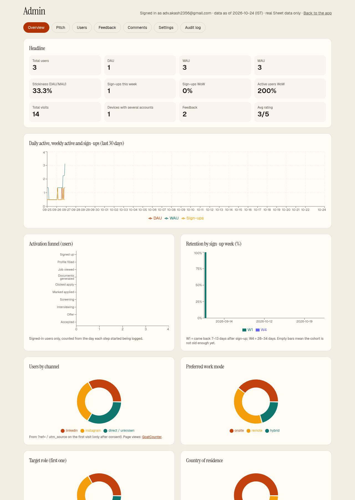
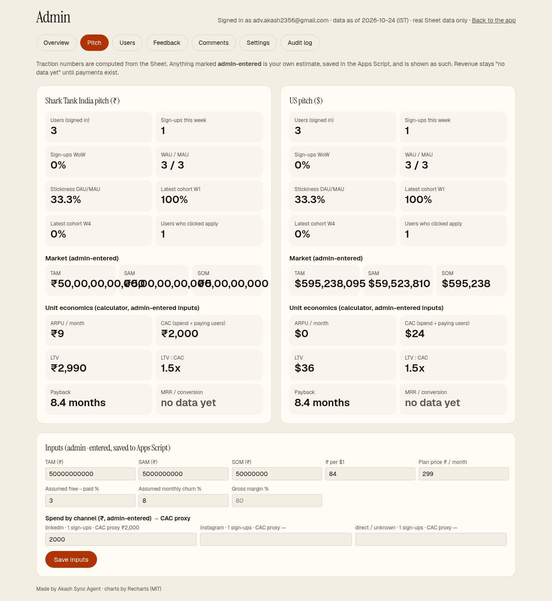

# Job Acquisition OS

A free job-search workspace that takes you from finding a role to accepting an offer. Your resume and jobs stay in your browser.

**Live:** https://akash-sharma-job-acquisition-os.vercel.app · **Made by Akash Sync Agent**



## What it does
| Step | What you get |
|---|---|
| **Find** | Real postings from [FreeHire](https://github.com/strelov1/freehire) (MIT, keyless public API), filtered by country, work mode and eligibility ("Remote: accepts India", onsite city, visa). Each job keeps its original link, source and posted date; the app never invents jobs. Government notices are kept only with an official .gov.in/.nic.in link and a future last date. |
| **Score** | Gemini scores fit against **your own resume**. If AI fails, a labelled keyword score is used. |
| **Job facts** | Salary (or "Not disclosed"), employment type, experience, shift / time zone, location and who can apply, all parsed from the posting. |
| **Tailor** | Tailored resume (JSON Resume schema, ATS layout), cover letter and recruiter-read simulation, with a fact check that flags numbers, names and skills not in your resume. PDF and DOCX exports are labelled as AI-assisted. |
| **Apply** | You apply on the employer's site yourself. After you click "Apply on site" and confirm, the job moves to **Applied**. |
| **Track** | Application tracker with 8 stages (Saved → Applied → Screening → Interviewing → Offer → Accepted, plus Rejected and Withdrawn), stage dates, a next action with a due date, and .ics reminders. |
| **Interviews** | Add rounds by hand or automatically: an optional **Google Calendar** scan (read-only), a **pasted invite email**, or an **.ics file**. AI finds the company, round, time (converted to your time zone) and meeting link, then matches the invite to a tracked job. Nothing is added until you confirm. |
| **Prepare** | Per-round prep (recruiter, HR, technical, hiring manager, panel, salary): likely questions, STAR drafts built only from your resume facts, red flags with honest fixes, and questions to ask. Includes an AI **mock interview** that scores each answer. |
| **Profile match** | Paste your LinkedIn Experience section or upload your LinkedIn data export (Positions.csv, Skills.csv, Email Addresses.csv) to find jobs, dates, email and skills that differ from your resume. Browser-only, no AI, no LinkedIn access or scraping. Merged from the Autonomous Job Outreach and LinkedIn footprint mapper repos. |
| **Outreach** | Drafts you send yourself (Gmail compose link or .eml). The app never sends outreach for you. Test mode prefixes `[TEST - please ignore]`. |
| **Report** | Weekly progress PDF, insights, milestones, CSV export and a JSON backup. |

| | |
|---|---|
|  |  |
|  |  |

*Screenshots use test data.*

## Sign-in
- **Google sign-in is required** for the app; public pages (landing, About, Privacy, Terms, Security, Accessibility, Feedback) stay open. There is no guest mode. If `GOOGLE_CLIENT_ID` is missing, the app shows "Sign-in unavailable".
- Clicking "Start" opens Google straight away (One Tap / FedCM prompt, plus Google's own button). The notice under it says that by continuing you confirm you are 18 or older and accept the Terms and Privacy policy. A mobile number is **optional** and sits in a collapsed section.
- Every app API (`/api/ai/*`, `/api/jobs/*`, `/api/admin/*`) requires a Google ID token in `Authorization: Bearer`. The server checks the audience (= `GOOGLE_CLIENT_ID`), issuer and expiry with `google-auth-library`, and returns 401 if any check fails. The client refreshes the token silently, retries once, and otherwise asks you to sign in again without losing your work.
- No OAuth client secret is used anywhere.



## Privacy summary
Full text: [/privacy](https://akash-sharma-job-acquisition-os.vercel.app/privacy).
- **In your browser only:** resume, jobs, notes, interview rounds, preferences and your Gemini key. They are stored in `localStorage` per Google account and do not sync across devices. "Delete everything" is on the Privacy page.
- **Sent to the owner's Google Sheet** (via Apps Script):
  - when you sign in: your Google name and email, an optional mobile number, visit dates and count, a random device id, a light device hint, your user agent and your first referral link;
  - feedback you send;
  - anonymous funnel steps, including the role, country and work mode you chose.
- **Sent to Google Gemini**, per AI request: your resume text and the job text, or interview-invite text. The free tier may use this content to improve Google's products.
- **Sent to FreeHire:** only job titles, country and city, entry-level and government flags. Never your resume, name or phone number.
- **Google Calendar (optional):**
  - the scope is `calendar.events.readonly` only, with incremental consent;
  - the token stays in memory in your browser tab and is never stored on our server;
  - "Disconnect" revokes it.
- **No Gmail scope** is requested.
- **Analytics:** GoatCounter counts anonymous steps without cookies. It is **off until you allow it**, and it respects GPC and Do Not Track.
- No ad scripts, and the site sets no cookies of its own (Google sign-in may set Google's).

## Admin (owner only)
Sign in normally with the `ADMIN_EMAIL` account, and an **Admin** link appears in the sidebar. The server confirms it from your verified token, and `/admin` returns 404 for everyone else. Every admin action re-verifies the token and is written to the **Admin log**.
- **Overview:**
  - DAU/WAU and sign-up trends;
  - the funnel (visit → profile → job viewed → applied → stages);
  - cohorts;
  - pie charts of channel, work mode, role, country and device;
  - feedback sentiment and themes.
- **Pitch:** Shark Tank India (₹) and US ($) sections built from real metrics, with TAM/SAM/SOM and pricing that you enter yourself. Also a unit-economics calculator and a CAC proxy by channel; revenue fields are marked as placeholders.
- **Users:** search and CSV export, a multi-account review flag, and DPDP deletion. Deleting needs the email typed again, and removes the user's rows from Users, Events, Feedback and Comments.
- **Feedback:** set the status, reply, and export as CSV.
- **Comments:** publish, hide or flag.
- **Settings:**
  - a site banner;
  - the auto-reply mode (stays **test** until you switch it);
  - a pricing switch (off by default; Razorpay is a stub).

| | |
|---|---|
|  |  |

## Setup
```
npm install
npm run dev      # http://localhost:3000 (Express mirror in server.ts)
npm run build    # Vite client + build/server.cjs
npm test
```
On Vercel, the APIs run as functions in `api/` and share `server/` with `server.ts`.

**Environment variables** (see `.env.example`):
| Name | Required | Purpose |
|---|---|---|
| `GOOGLE_CLIENT_ID` / `VITE_GOOGLE_CLIENT_ID` | yes | OAuth Web client ID, the same value in both |
| `FEEDBACK_SCRIPT_URL`, `FEEDBACK_SECRET` | for Sheet logging and admin | Apps Script Web app URL and shared secret |
| `ADMIN_EMAIL` | for /admin | Owner Google email |
| `GEMINI_API_KEY` | optional | Server fallback key; users can add their own free key in Settings |
| `VITE_GOATCOUNTER_CODE` | optional | GoatCounter site code, or `off` |

**Google Cloud OAuth:**
1. Create a Web client and add the site under Authorised JavaScript origins.
2. Under Data access, add the scopes `openid`, `email`, `profile` and the optional `https://www.googleapis.com/auth/calendar.events.readonly`.
3. Enable the Google Calendar API.

The calendar scope is **sensitive**. Users see Google's "unverified app" warning until you publish the app and pass Google's verification, which needs a privacy policy link, a verified domain and a demo video. No paid security assessment is needed. Details are in `docs/FEEDBACK_SETUP.md`.

### Apps Script (owner Google Sheet)
1. Create a Google Sheet, then go to Extensions → Apps Script and paste `scripts/apps-script/Code.gs`.
2. In Script properties, set `SECRET` (the same value as `FEEDBACK_SECRET`) and `NOTIFY` (your email). `AUTO_REPLY_MODE` defaults to `test`.
3. Run **setup** once. It creates the Users, Events (with Detail), Feedback, Comments, Config and Admin log tabs.
4. Deploy as a Web app (execute as you; access: anyone). Put the URL in `FEEDBACK_SCRIPT_URL`.
5. After every Code.gs change, create a **new deployment version**.

Full guide: `docs/FEEDBACK_SETUP.md`. Search Console and Bing: `docs/SEO_SETUP.md`.

## Licence, credits and copyright
- Code: **MIT** © 2026 Akash Sync Agent (Akash Sharma). See [`LICENSE`](LICENSE).
- **Brand not licensed** ([`NOTICE`](NOTICE)): the names "Akash Sync Agent" and "Job Acquisition OS", the logo and the OG card may not be reused. Forks must rebrand.
- Third-party work, all under MIT, Apache-2.0, BSD or ISC:
  - FreeHire;
  - JSON Resume schema;
  - RenderCV and jsonresume-theme-even layouts;
  - JobSync and JobHunter (ideas only);
  - Recharts and its d3 dependencies;
  - google-auth-library;
  - and others.

  Authors and licence texts: [`THIRD_PARTY_NOTICES.md`](THIRD_PARTY_NOTICES.md).
- The app shows **"Made by Akash Sync Agent"** in the footer, the sidebar, the About page and, optionally, in exported files.

More docs: `docs/PROMISE_AUDIT.md` (each landing claim and its status), `docs/LEGAL_COPY_AUDIT.md`, `docs/FREEHIRE.md`, `DESIGN.md`.
